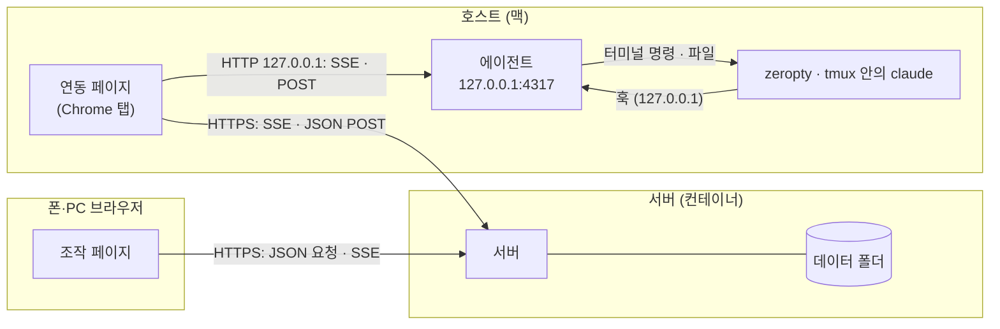
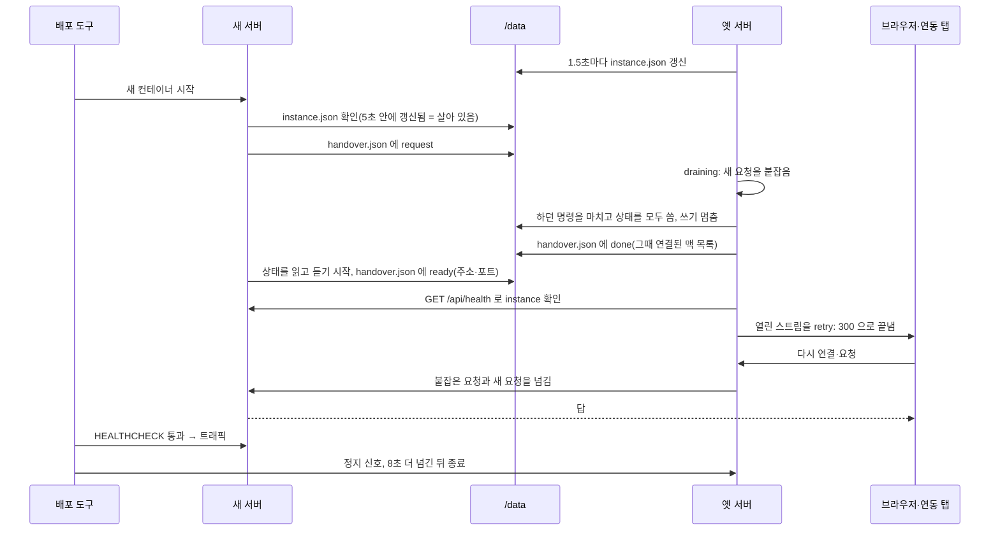

# 구성과 연결

이 페이지는 Agent Bridge 의 네 구성 요소와, 그 사이의 연결을 누가 어떻게 여는지 설명해요. 설치 절차는 [시작하기](/guide/getting-started)를 보세요.

그림의 화살표는 연결을 여는 쪽에서 받는 쪽으로 향해요. 맥 안의 에이전트에서 서버로 가는 화살표는 없어요. 서버와 에이전트 사이는 늘 맥의 브라우저 탭이 이어요.

## 네 구성 요소

| 구성 요소 | 어디서 도나요 | 하는 일 |
|---|---|---|
| **서버** | 직접 올린 컨테이너(Go 바이너리 하나) | GitHub 로그인, 호스트 등록, 메시지 중계, 이벤트 번호 매기기, 옮기기 진행, 알림과 웹 푸시 |
| **연동 페이지** | 호스트(맥)의 Chrome 탭. `SITE/bridge` 또는 같은 브라우저의 조작 페이지 | 에이전트의 메시지를 서버로, 서버의 명령을 에이전트로 옮겨요(**중계**) |
| **에이전트** | 호스트의 `~/.claude-bridge/agent.mjs`, launchd 서비스 | Claude Code 를 터미널에 띄우고, 화면과 대화 파일을 읽고, 글과 키를 넣어요 |
| **조작 페이지** | 폰·PC 브라우저의 `SITE` | 세션 목록, 대화, 카드, 설정을 보여 주는 화면이에요 |

**호스트**는 에이전트가 설치된 맥 한 대예요. 사용자 한 명이 여러 호스트를 연결할 수 있어요. 세션은 한 번에 한 호스트에서만 돌아요.

## 누가 어떤 연결을 여나요

| 구간 | 여는 쪽 | 방식 |
|---|---|---|
| 조작 페이지 → 서버 | 조작 페이지 | 상태와 이벤트는 SSE(Server-Sent Events) 스트림 하나로 받고, 조작은 JSON POST 로 보내요 |
| 연동 페이지 → 서버 | 연동 페이지 | `POST /api/bridge/hello` 로 등록하고, SSE `GET /api/bridge/stream` 으로 명령을 받고, `POST /api/bridge/up` 으로 에이전트 메시지를 묶어 올려요 |
| 연동 페이지 → 에이전트 | 연동 페이지 | SSE `GET http://127.0.0.1:<포트>/events` 로 받고, `POST /cmd` 로 명령을 건네요. 기본 포트는 4317 이에요 |
| Claude Code → 에이전트 | Claude Code 의 훅 | 훅과 상태 줄 명령이 `curl` 로 `127.0.0.1` 의 `/hook`, `/statusline` 에 알려요 |
| 에이전트 → 터미널 | 에이전트 | zeropty 또는 tmux 명령으로 세션을 띄우고, 화면을 읽고, 글을 넣어요 |

양쪽 모두 WebSocket 이 아니라 SSE 와 HTTP POST 를 써요. 브라우저 페이지는 Content-Security-Policy 로 자기 사이트와 `http://127.0.0.1:*` 에만 연결할 수 있어요. 이름은 `localhost` 가 아니라 늘 `127.0.0.1` 을 써요.

## 에이전트는 서버에 연결하지 않아요

에이전트는 `127.0.0.1` 에서만 듣고, 서버로 나가는 연결을 만들지 않아요. 서버와 오가는 것은 모두 연동 페이지의 브라우저 JavaScript 를 거쳐요. 그래서 맥의 사이트 탭을 모두 닫으면 그 맥은 서버에서 끊기고, 다시 열면 붙어요.

설치가 끝나면 터미널에도 같은 말이 찍혀요. "에이전트는 혼자서는 바깥과 통신하지 않습니다. 이 맥의 브라우저에 연동 페이지를 열어 둔 동안만 사이트에 연결됩니다."

에이전트가 바깥에 닿는 경우는 두 가지예요.

- **zeropty 받기.** 에이전트는 세션 터미널로 쓰는 zeropty 를 정해진 GitHub 릴리스 주소에서 받아요. 서버가 아니라 고정된 주소이고, 받은 묶음의 SHA-256 이 맞을 때만 설치해요.
- **헤드리스 연동 모드.** 호스트마다 켜는 스위치예요. 켜면 에이전트가 그 맥의 Chrome 을 화면 없이 띄워 연동 페이지를 맡겨요. 잇는 것은 여전히 브라우저지만, 그 브라우저를 에이전트가 띄우므로 "에이전트는 혼자서는 바깥과 연결하지 않는다" 가 그 맥에서는 성립하지 않아요. 기본은 꺼짐이에요. 자세한 내용은 [맥을 늘 연결해 두기](/guide/use/always-on)를 보세요.

## 에이전트 하나에 탭 하나

한 에이전트를 동시에 중계하는 탭은 하나뿐이에요.

- **같은 브라우저 안:** 탭들은 에이전트 포트마다 하나의 자리를 두고 줄을 서요(`navigator.locks`). 자리를 쥔 탭만 중계하고, 나머지는 "이 사이트의 다른 탭이 연동 중" 을 보이며 기다려요.
- **넘겨받기:** 기다리는 탭이 화면에 보이고 있고, 중계하던 탭이 7초 동안 말이 없거나 20초 넘게 고장이면 그 탭이 자리를 넘겨받아요.
- **다른 브라우저:** 다른 브라우저에서 새로 등록하면 서버가 새 연결을 이기게 해요. 먼저 잇던 탭은 "다른 탭이나 브라우저가 연동을 넘겨받음" 을 보이고 멈춰요.

맥의 Chrome 에 조작 페이지를 열어 두면, 연결 정보가 있는 한 그 페이지가 뒤에서 중계를 맡아요. `/bridge` 를 따로 열어 둘 필요는 없어요.

## 무엇이 어디에 있나요

| 위치 | 담는 것 |
|---|---|
| 서버 데이터 폴더(`BRIDGE_DATA`, 이미지 기본 `/data`) | 계정, 로그인 토큰의 해시, 접근 요청, 호스트 기록, 세션 정보(제목, 미리보기 80자, 상태, 맥, 작업 폴더, PR 링크, 통계 숫자), 그룹, 알림, 웹 푸시 구독, 플러그인 설정, 호스트 로그 |
| 서버 메모리 | 세션마다 최근 이벤트 1,000개, 옮기는 동안의 대화 사본. 서버를 다시 시작하면 사라져요 |
| 맥의 `~/.claude-bridge/` | `agent.json`(설정, 호스트 id, 에이전트 키), `sessions.json`, `hooks.json`, `events/<세션 id>.jsonl`(세션 기록), `images/`, `overwritten/`, `zeropty/`, `agent.log`, `service.log` |
| 맥의 Claude Code 폴더(`~/.claude/projects/`) | 대화 원본(트랜스크립트) |
| 폰·PC 브라우저 | 본 대화의 캐시(IndexedDB), 연동 정보(`cb.agent`, 맥의 브라우저만) |

서버는 대화 원본, 화면 이벤트, 그림을 디스크에 쓰지 않아요. 맥의 경로 전체는 [맥의 파일과 경로](/reference/files)를 보세요.

## 서버를 바꿀 때

서버를 새 버전으로 바꿀 때는 옛 서버가 새 서버에 상태와 요청을 넘겨줘요(**넘겨주기**). 두 서버가 같은 데이터 폴더를 몇 초 동안 함께 써요. 그동안 쓰는 쪽은 언제나 하나예요. 옛 서버가 쓰기를 멈춘 뒤에 새 서버가 읽어요. 배포 절차는 [끊기지 않는 배포](/guide/operate/deploy)를 보세요.

새 서버가 켜지면 데이터 폴더의 `instance.json` 을 봐요. 5초 안에 갱신된 기록이 있으면 돌고 있는 서버가 있다는 뜻이에요. 새 서버는 `handover.json` 에 상태를 달라고 적어요.

옛 서버는 300 ms 마다 이 파일을 봐요. 요청을 보면 새로 오는 요청을 붙잡아 둬요. 맥의 답을 기다리는 명령이 있으면 3초까지 기다리고, 플러그인을 멈추고, 상태를 디스크에 모두 쓴 뒤 쓰기를 멈춰요. 그리고 그때 연결돼 있던 맥 목록을 함께 적어 넘겨요.

새 서버는 상태를 읽고 듣기 시작한 뒤 자기 주소와 포트를 적어요. 옛 서버는 그 주소의 `/api/health` 가 새 서버의 `instance` 로 답하는지 확인해요. 그다음부터 붙잡은 요청과 새 요청을 모두 새 서버로 넘기고, 응답을 그대로 돌려줘요.

| 단계 | 시간 |
|---|---|
| 새 서버가 옛 서버의 done 을 기다림 | 20초. 넘으면 디스크에 있는 것으로 시작 |
| 옛 서버가 새 서버의 ready 를 기다림 | 25초. 넘으면 상태를 되찾고 다시 혼자 돌아요 |
| 새 서버 주소 확인(`/api/health`) | 주소마다 1.5초 |
| 정지 신호 뒤 옛 서버가 더 넘겨주는 시간 | 8초 |
| 넘겨받은 새 서버가 이전 맥을 기다리는 시간 | 6초 |

두 서버가 서로 넘기는 요청에는 데이터 폴더의 `handover.secret` 값이 머리글로 붙어요. 이 값이 맞는 요청만 넘겨받은 요청으로 처리해요.

### 맥의 세션은 어떻게 되나요?

서버를 바꾸는 중에도 맥에서 도는 세션은 멈추지 않아요. 세션은 맥의 터미널 프로그램(zeropty 또는 tmux)에서 계속 돌아요. 연동 탭과 조작 페이지는 스트림이 끝나면 300 ms 뒤 다시 붙어요.

새 서버는 넘겨받은 직후 6초까지, 이전에 연결돼 있던 맥이 다시 붙기를 기다린 뒤 조작 요청을 처리해요. 그래서 그 짧은 순간에 보낸 메시지도 실패하지 않아요. 에이전트는 다시 붙은 뒤 그 사이의 대화를 이어서 올려요.

### 에이전트 자동 업데이트

새 버전에서 에이전트 파일이 바뀌었으면 서버의 에이전트 build 가 달라져요. 서명이 맞으면 서버는 다시 연결되는 맥마다 새 파일과 서명을 보내요. 맥은 서명을 확인하고 세션이 쉴 때 바꿔 다시 시작해요. 서명이 맞지 않으면 서버는 보내지 않아요. 자세한 내용은 [에이전트 서명 키](/guide/operate/signing)를 보세요.

## 왜 이렇게 했나요?

**맥에 들어오는 연결을 만들지 않으려고요.** 연결을 여는 쪽이 언제나 맥의 브라우저라서, 맥에 포트를 열거나 공유기를 설정할 필요가 없어요. 터널, VPN, 고정 IP 도 필요 없어요. 집과 회사처럼 네트워크가 다른 곳의 맥도 브라우저만 사이트에 닿으면 연결돼요.

**에이전트를 바깥과 떼어 두려고요.** 에이전트는 `127.0.0.1` 에만 있고, 사이트 출처와 키를 확인한 요청만 받아요. 서버에 로그인하는 것은 에이전트가 아니라 브라우저예요.

**대가는 탭이에요.** 맥에 사이트 탭이 열려 있어야 연결돼요. 탭을 닫거나 브라우저를 끄면 그 맥의 세션은 폰에서 조작할 수 없어요. 맥이 끊긴 동안 조작 페이지는 기기에 남은 대화만 보여 줘요. 연동 페이지는 Chrome 이 필요하고, Chrome 이 로컬 네트워크 접근을 물으면 허용해야 해요. 이 대가를 줄이는 방법이 헤드리스 연동 모드예요. 대신 그 맥에서는 에이전트가 브라우저를 띄우고, 메모리를 수백 MB 더 써요.

## 다음 단계

- [세션의 일생](/guide/concepts/sessions): 에이전트가 세션을 띄우고 상태를 읽는 방법을 알아봐요.
- [보안 모델](/guide/concepts/security): 각 연결이 무엇으로 지켜지는지 알아봐요.
- [맥을 늘 연결해 두기](/guide/use/always-on): 탭 없이 연결을 유지하는 절차예요.
- [주소와 HTTP API](/reference/routes): 경로 전체를 찾아봐요.
