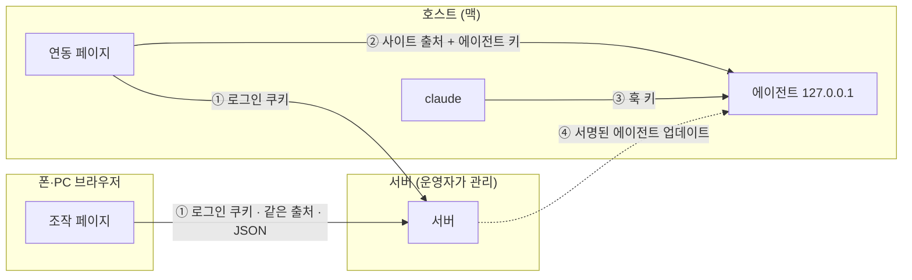

# 보안 모델

이 페이지는 Agent Bridge 의 신뢰 경계와, 각 경계를 지키는 장치를 설명해요. 서명 키를 만드는 절차는 [에이전트 서명 키](/guide/operate/signing)를, 세션을 잠그는 절차는 [목록 정리와 잠금](/guide/use/organize)을 보세요.

그림의 번호는 경계예요. ① 서버는 로그인한 허용 사용자의 요청만 받아요. ② 에이전트는 사이트 출처와 키를 낸 요청만 받아요. ③ 훅은 별도의 훅 키를 내요. ④ 서버가 보내는 에이전트 코드는 운영자의 서명이 맞을 때만 설치돼요.

## 서버를 믿어야 해요

서버는 연결된 맥의 세션에 글을 넣고, 확인 창에 답하고, 새 세션을 띄울 수 있어요. 곧 맥의 Claude Code 가 할 수 있는 일을 서버도 시킬 수 있어요. 직접 운영하거나 믿을 수 있는 사람이 운영하는 서버에만 맥을 연결하세요.

- **종단간 암호화는 없어요.** 대화는 HTTPS 로 오가지만, 서버는 중계하는 동안 대화 내용을 볼 수 있어요.
- **처음 설치는 서버를 믿어요.** `curl -fsSL SITE/install.sh | bash` 는 서버가 주는 스크립트와 에이전트 파일을 그대로 받아 실행해요. 이때는 문법 검사(`node --check`)만 하고 서명은 확인하지 않아요. 서명 확인은 설치한 뒤의 자동 업데이트부터 적용돼요.
- **사용자끼리는 나뉘어요.** 남의 세션은 `세션이 없습니다`, 남의 호스트는 `호스트가 없습니다` 로 404 예요. 운영자만 모든 호스트의 상태와 로그를 볼 수 있어요.

## 맥의 에이전트

| 장치 | 내용 |
|---|---|
| 듣는 주소 | `127.0.0.1` 만, 기본 포트 4317. 같은 네트워크의 다른 기기는 닿을 수 없어요 |
| 출처 확인 | `Origin` 머리글이 있으면 사이트 주소와 같아야 해요. 다르면 403 이에요 |
| 에이전트 키 | `/events`, `/cmd` 는 맥마다 만든 키(24 byte 난수)가 있어야 해요. 없거나 틀리면 401 이에요 |
| 훅 키 | 브리지 세션의 훅은 에이전트 키와 다른 훅 키를 써요. 훅 키는 `/hook`, `/statusline` 에서만 통해요 |
| 파일 권한 | `~/.claude-bridge/` 는 0700, `agent.json` 같은 설정 파일은 0600 이에요 |

에이전트 키는 `agent.json` 에 있어요. 연동 링크의 주소 조각(`#port=…&key=…`)으로 브라우저에 건네지고, 연동 페이지가 읽은 뒤 주소창에서 지워요. 브라우저는 키를 `localStorage` 에 두고 서버로 보내지 않아요. 키는 명령줄 인자나 환경 변수에 싣지 않아요. 예외는 헤드리스 연동 모드를 처음 띄울 때로, 그때는 Chrome 명령줄의 주소에 키가 실려 `ps` 로 보여요.

조작 페이지와 연동 페이지는 Content-Security-Policy 로 자기 사이트와 `http://127.0.0.1:*` 에만 연결할 수 있어요.

## 서명된 에이전트 업데이트

서버는 새 에이전트 파일을 연결된 맥에 자동으로 보내요. 서버가 뚫리면 이 길로 맥에 코드를 심을 수 있으므로, 에이전트는 서명이 맞는 업데이트만 설치해요.

1. 운영자는 에이전트 파일 목록으로 매니페스트를 만들어요. 파일마다 이름, 바이트 길이, SHA-256 이 한 줄이고, 앞에 순번(`seq`)이 붙어요.
2. 운영자는 자기 맥에 둔 [ed25519](https://ed25519.cr.yp.to/) 비밀키로 매니페스트에 서명해요. 서명과 순번은 `agent/agent.sig` 에 들어가요. 비밀키는 저장소나 서버에 두지 않아요.
3. 에이전트는 받은 파일로 매니페스트를 다시 만들고, `agent/keys.mjs` 의 공개키 두 개(주 키, 예비 키) 중 하나로 서명을 확인해요.
4. 순번이 지금 설치된 것보다 작으면 버려요. 서버가 옛 판으로 되돌릴 수 없어요.

`keys.mjs` 도 서명되는 파일 중 하나예요. 그래서 서버가 공개키를 바꿔 끼우면 서명이 맞지 않아요. 새 키는 이미 믿는 키로 서명한 업데이트로만 맥에 들어가요. 저장소를 포크해 직접 운영한다면 자기 키를 만들어야 해요. 절차는 [에이전트 서명 키](/guide/operate/signing)를 보세요.

자동 업데이트를 받지 않으려면 에이전트를 `--no-auto-update` 로 실행하세요.

에이전트가 받는 [zeropty](https://github.com/CreatiCoding/zeropty) 도 같은 원리로 지켜요. 버전, 주소, SHA-256 이 서명된 파일(`agent/mux.mjs`)에 고정돼 있어요. 받은 묶음의 해시가 다르면 아무것도 설치하지 않고 30분 뒤 다시 시도해요.

## 로그인과 요청 보호

- **로그인.** GitHub OAuth 로 로그인하고, 허용 목록에 있거나 운영자가 허용한 계정만 들어와요. 허용을 거두면 다음 요청부터 막혀요.
- **쿠키.** 로그인 쿠키는 `HttpOnly`, `SameSite=Lax` 이고, `https` 사이트에서는 `Secure` 와 `__Host-` 접두사가 붙어요. 30일 동안 유효해요. 서버는 토큰 원문이 아니라 SHA-256 해시만 저장해요.
- **다른 출처 막기(CSRF 방어).** `/api/*` 의 GET 이 아닌 요청에 다른 사이트의 `Origin` 이 붙어 있으면 403 `다른 출처의 요청입니다` 예요. POST 는 `Content-Type: application/json` 이어야 하고, 아니면 415 예요. 다른 사이트의 폼은 이 형식으로 보낼 수 없어요.
- **횟수 제한.** 로그인 경로는 주소마다 60초에 20번, 잠금 시도는 60초에 10번까지 받아요.
- **보안 머리글.** 페이지에는 Content-Security-Policy, `X-Content-Type-Options: nosniff`, `Referrer-Policy: no-referrer` 가 붙어요.

## 세션 잠금

**잠금**은 세션에 거는 비밀번호 보호예요.

1. 브라우저는 비밀번호를 그대로 보내지 않아요. `claude-bridge-lock:` 을 앞에 붙인 비밀번호의 SHA-256 16진수를 **증명**으로 보내요.
2. 서버는 16 byte 난수 소금으로 증명을 PBKDF2-SHA256(Password-Based Key Derivation Function 2) 120,000회로 늘려, 소금과 결과만 세션 정보에 저장해요.
3. 잠금을 풀면 서버가 **열쇠**를 줘요. 열쇠는 그 탭의 `sessionStorage` 에 있고, 12시간 동안 유효해요. 서버를 다시 시작하면 무효가 돼요.

잠긴 세션은 열쇠 없이 이렇게 보여요.

| 항목 | 잠긴 동안 |
|---|---|
| 제목 | 사람이 붙인 이름이면 그대로, 아니면 `잠긴 세션` |
| 작업 폴더, 미리보기, 쓰는 중인 글 | 비어 있어요 |
| 대화, 화면 | 실시간 이벤트와 화면을 보내지 않고, 대화를 열려면 열쇠가 필요해요 |
| 알림 | 제목 `잠긴 세션`, 내용 `확인할 것이 있어요` |
| 플러그인(Slack) | 잠긴 세션을 열 수 없어요 |
| 서버 디스크 | 미리보기와, 사람이 붙이지 않은 제목을 쓰지 않아요 |

잠금은 화면과 목록을 가리는 장치이고, 대화를 암호화하지 않아요. 대화의 원본은 맥에 그대로 있어요.

## 알림과 웹 푸시

웹 푸시는 VAPID(Voluntary Application Server Identification) 로 서명한, 본문이 없는 요청이에요. 푸시를 받은 서비스 워커가 서버에 로그인한 채로 `GET /api/notices` 를 불러 알림 내용을 가져와요. 그래서 브라우저의 푸시 서비스는 알림 내용을 보지 못해요. 잠긴 세션의 알림은 서버 안에서도 고정 문구예요.

## 서버에 남는 것

서버는 데이터 폴더(`BRIDGE_DATA`)의 파일에만 상태를 둬요. 데이터베이스는 쓰지 않고, 파일은 암호화하지 않은 평문이에요. 데이터 폴더를 읽을 수 있는 사람은 아래 내용을 모두 볼 수 있어요.

- GitHub 로그인 이름, 표시 이름, 아바타 주소
- 로그인 토큰의 해시와 만료, 접근 요청 기록
- 호스트 기록(이름, 종류, 홈 경로, 에이전트 정보)
- 세션 정보(제목, 미리보기 80자, 상태, 맥, 작업 폴더, PR 링크, 통계 숫자). 잠긴 세션은 제목과 미리보기가 없어요
- 그룹, 기본 프롬프트, 알림(30일), 웹 푸시 구독 주소, 플러그인 설정, 호스트 로그

대화 원본, 화면 이벤트, 그림은 저장하지 않아요. 예전 판의 서버가 저장한 대화 파일은 운영자가 정리할 때까지 남아요. IP 주소는 횟수 제한을 위해 메모리에만 두고 디스크와 실행 로그에 쓰지 않아요.

## 왜 이렇게 했나요?

**맥으로 들어오는 길을 없앴어요.** 에이전트는 `127.0.0.1` 에만 있고, 브라우저 탭이 바깥으로 연결을 열어요. 바깥에서 맥에 닿는 포트가 없으므로, 공격자는 사이트에 로그인한 사용자의 브라우저나 서버를 거쳐야 해요.

**서버를 믿되, 코드는 서명으로 묶었어요.** 서버가 세션을 조작하는 것은 이 제품의 기능이라 막을 수 없어요. 대신 서버가 뚫려도 맥의 에이전트 코드를 바꾸지는 못하게 업데이트에 서명을 요구해요. 대가로 운영자가 서명 키를 관리해야 하고, 첫 설치는 여전히 서버를 믿어요.

**비밀번호는 서버에 가지 않아요.** 브라우저가 증명만 보내고 서버는 그것을 다시 늘려 저장하므로, 데이터 폴더에는 비밀번호 원문이 없어요.

**대화는 서버에 두지 않아요.** 서버에 남는 개인 정보를 줄이려고 대화를 맥에 두고 서버는 중계만 해요. 대가로 맥이 꺼져 있으면 그 세션의 대화를 서버에서 볼 수 없어요.

## 다음 단계

- [에이전트 서명 키](/guide/operate/signing): 서명 키를 만들고 업데이트에 서명하는 절차예요.
- [목록 정리와 잠금](/guide/use/organize): 세션을 잠그고 푸는 절차예요.
- [접근 관리와 운영 화면](/guide/operate/admin): 계정을 허용하고 거두는 절차예요.
- [환경 변수](/reference/env): `GITHUB_ALLOWED_LOGINS`, `BRIDGE_ADMIN_LOGINS` 같은 설정을 찾아봐요.
