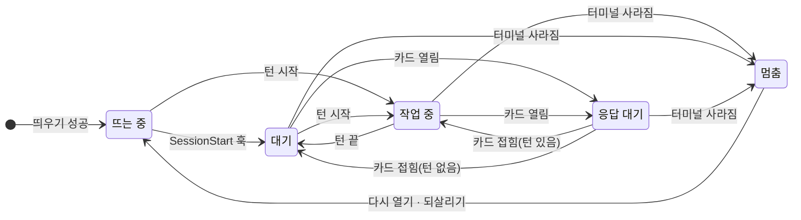

# 세션의 일생

이 페이지는 세션이 어떤 상태를 오가는지, 에이전트가 그 상태를 어떻게 알아내는지, 카드와 붙잡은 글이 왜 생기는지 설명해요. 폰에서 세션을 다루는 절차는 [폰에서 세션 다루기](/guide/use/sessions)를 보세요.

**세션**은 서버가 관리하는 Claude Code 실행 하나예요. 세션 id 는 세션이 끝날 때까지 그대로예요. **대화**는 Claude Code 의 트랜스크립트와 그 id 예요. `/clear` 를 하면 대화는 바뀌어도 세션은 그대로예요.

그림은 에이전트가 계산하는 다섯 상태와 그 사이의 이동을 보여 줘요. 어느 상태에서든 세션을 끝내거나 다른 맥으로 내려놓으면 에이전트의 목록에서 빠져요.

## 상태

에이전트는 상태를 저장하지 않고 매번 계산해요. 여러 조건이 겹치면 멈춤 > 뜨는 중 > 응답 대기 > 작업 중 > 대기 순으로 앞의 것이 이겨요.

| 화면 표시 | 내부 이름 | 뜻 |
|---|---|---|
| 뜨는 중 | `starting` | `claude` 가 뜨는 중이에요. 시작 확인 창이 떠 있을 수 있어요 |
| 대기 | `idle` | 입력을 기다리며 쉬고 있어요 |
| 작업 중 | `busy` | 턴이 돌고 있어요. 경우에 따라 "코딩 중" 으로 보여요 |
| 응답 대기 | `waiting` | 사람의 결정이 필요해요. 카드 종류에 따라 "권한 요청", "질문", "플랜 승인", "터미널 확인", "지시 대기" 로 보여요 |
| 멈춤 | `ended` | 터미널 세션이 사라졌어요. 세션은 목록에 남고, 글을 보내면 같은 맥에서 같은 대화로 다시 열어요 |

조작 페이지는 세션 쪽 표시도 함께 보여요. 사람이 끝낸 세션은 **끝남**, 쉬게 표시한 세션은 **휴면**, 옮기는 동안은 **옮기는 중**, 맥이 끊기면 **기기 끊김**이에요. 전체 목록은 [세션 상태와 카드](/reference/states)를 보세요.

## 상태를 아는 방법

에이전트는 두 가지를 함께 읽어요.

**Claude Code 훅.** 에이전트는 세션을 띄울 때마다 `~/.claude-bridge/hooks.json` 을 쓰고, `claude` 명령줄에 `--settings` 로 넘겨요. 훅은 9개예요: `SessionStart`, `UserPromptSubmit`, `PreToolUse`, `PostToolUse`, `PostToolUseFailure`, `Stop`, `Notification`, `SessionEnd`, `PermissionRequest`. `PermissionRequest` 는 세션이 **전부 허용**일 때 확인 창이 그려지기 전에 허용을 답하는 데 써요. 훅 명령은 환경 변수 `CB_HOOK` 이 있을 때만 `127.0.0.1` 의 에이전트에 알려요. 이 변수는 에이전트가 띄운 세션의 터미널에만 넣으므로, 맥에서 직접 연 Claude Code 에는 영향이 없어요. 사람의 `~/.claude/settings.json` 도 건드리지 않아요.

**터미널 화면.** 훅으로는 터미널에 그려진 확인 창을 알 수 없어요. 그래서 에이전트는 700 ms 마다 세션을 돌며 대화 파일을 읽고, 1,500 ms 마다 화면을 봐요. 훅이 한 번도 오지 않은 세션은 화면만으로 턴을 판정하고, 훅을 놓쳐 열린 채인 턴은 15초 뒤에 닫아요.

## 세션 기록과 순번

1. 에이전트는 대화 파일에 새로 붙은 완성된 줄만 연동 페이지를 거쳐 서버로 보내요.
2. 서버는 줄을 화면에 그릴 **이벤트**로 바꾸고, 세션마다 1부터 1씩 늘어나는 순번(`seq`)을 매겨요.
3. 서버는 번호 매긴 이벤트를 맥에 다시 내려보내고, 맥은 `~/.claude-bridge/events/<세션 id>.jsonl` 에 둬요.
4. 서버는 같은 이벤트를 조작 페이지의 SSE 스트림으로 보내요. 한 세션의 이벤트는 순번이 늘어나는 차례로 도착해요.
5. 조작 페이지가 끊겼다 다시 붙으면, 마지막으로 받은 순번 뒤의 이벤트를 `GET /api/sessions/<세션 id>/events?after=<seq>` 로 500개씩 받아요.

서버는 세션마다 최근 이벤트 1,000개만 메모리에 둬요. 그보다 앞의 기록은 서버가 맥에 물어서 가져와요. 맥이 끊겨 있으면 조작 페이지는 기기에 캐시해 둔 대화와 "맥 연결 끊김" 띠를 보여 줘요.

## 카드

**확인 창**은 Claude Code 터미널에 그려진 번호·키 선택 창이에요. 에이전트는 확인 창을 읽어 조작 페이지에 **카드**로 올려요. 카드에 답하면 에이전트가 같은 키를 터미널에 눌러요.

| 종류 | 화면 표시 | 언제 열리나요 |
|---|---|---|
| `permission` | 권한 요청 | 도구 실행 권한을 물을 때 |
| `question` | 질문 | Claude 가 선택지로 물을 때 |
| `plan` | 플랜 승인 | 플랜을 받아들일지 물을 때 |
| `dialog` | 터미널 확인 | 그 밖의 번호 선택 창 |
| `keyed` | 터미널 확인 | 번호 없이 화살표와 Enter 로 고르는 창 |
| `stuck` | 지시 대기 | 중단 문구가 화면 마지막에 남아 다음 지시를 기다릴 때 |

몇몇 창은 사람에게 묻지 않고 에이전트가 넘겨요. 세션이 뜨는 중일 때의 폴더 신뢰, 개발 채널, Claude in Chrome 확장 창이고, 모델을 바꾼 직후 30초 동안의 모델 전환 확인 창이에요. 넘긴 창은 대화에 한 줄로 남아요.

## 붙잡은 글

턴이 도는 동안 보낸 글은 바로 터미널에 넣지 않고 **붙잡은 글**로 기다려요. 에이전트는 도구 하나가 끝나거나, 턴이 끝나거나, 카드에 답한 뒤에 붙잡은 글을 한 덩어리로 넣어요. 지금 바로 넣고 싶으면 "지금 보내기" 로 도는 턴을 끊고 넣을 수 있어요.

카드가 열려 있을 때는 카드 종류에 따라 달라요. 질문·플랜·터미널 확인(`dialog`) 카드가 열려 있으면 그 창을 닫고 글을 메시지로 넣어요. 권한 요청과 `keyed` 카드는 키가 그 창에 들어가므로 글을 붙잡아요.

## 쓰는 중인 글

턴이 도는 동안 에이전트는 700 ms 마다 터미널 화면에서 Claude 가 쓰고 있는 글을 읽어 조작 페이지에 보내요. 그래서 답이 대화에 들어오기 전에도 쓰는 중인 글을 볼 수 있어요. 도구가 도는 화면에서는 미리보기를 보내지 않아요.

## 세션 터미널

에이전트는 `claude` 를 터미널 프로그램 안에서 띄워요. 기본은 에이전트가 받아 둔 [zeropty](https://github.com/CreatiCoding/zeropty) 0.1.3 이고, 준비되지 않았거나 `--mux tmux` 로 고정했으면 [tmux](https://github.com/tmux/tmux) 예요. zeropty 는 tmux 의 명령줄을 그대로 받으므로 에이전트의 동작은 같아요.

zeropty 서버는 에이전트와 따로 돌아요. 그래서 에이전트가 업데이트로 다시 떠도 세션은 끊기지 않고, 새 에이전트가 `sessions.json` 을 읽어 이어서 다뤄요.

## /clear 와 컨텍스트 압축

`/clear` 를 하면 Claude Code 는 새 대화 id 로 `SessionStart` 훅을 보내요. 에이전트는 세션의 대화를 새 id 로 바꾸고 새 대화 파일의 처음부터 읽어요. 세션 id, 목록의 자리, 그룹, 잠금은 그대로예요. 대화에는 "🧹 /clear · 대화가 초기화됐어요" 가 남아요. 컨텍스트 압축도 같은 방식이고 "📦 컨텍스트 압축 완료" 가 남아요.

## 다시 열기와 되살리기

**다시 열기**는 같은 맥에서 같은 대화로 Claude Code 를 다시 띄우는 일이에요. 멈춘 세션에 글을 보내면 서버가 먼저 다시 열고 글을 넣어요. 에이전트는 `claude --resume <대화 id>` 로 띄워요.

**되살리기**는 맥이 다시 켜진 뒤 에이전트가 스스로 세션을 다시 여는 일이에요. 에이전트는 켜질 때 12시간 안에 살아 있던 세션을 최근 것부터 5개까지 되살려요. 대화에는 "🔁 맥이 다시 켜져서 세션을 같은 대화로 다시 열었어요." 가 남고, 맥에 남아 있던 붙잡은 글은 2.5초 뒤에 들어가요. 6번째부터와 12시간이 지난 세션은 되살리지 않고, 글을 보내면 그때 다시 열려요.

## 왜 이렇게 했나요?

**훅과 화면을 함께 읽어요.** 훅은 턴의 시작과 끝을 정확히 알려 주지만, 확인 창은 알려 주지 않아요. 화면은 확인 창과 쓰는 중인 글을 보여 주지만, 그것만으로는 턴의 경계가 흐려요. 둘을 함께 쓰고 서로 놓친 것을 시간 제한으로 메워요.

**훅은 브리지 세션에만 걸어요.** 사람의 전역 설정을 바꾸지 않고 `--settings` 와 세션 전용 환경 변수를 쓰므로, 맥에서 직접 쓰는 Claude Code 는 평소대로 돌아요.

**글을 붙잡아요.** 도구가 도는 중에 터미널에 글을 넣으면 그 글이 다른 입력이나 확인 창의 키와 섞일 수 있어요. 기다렸다가 넣는 대신, 급하면 사람이 "지금 보내기" 를 고르게 했어요.

**순번은 서버가 매겨요.** 여러 기기가 같은 세션을 보더라도 순번 하나로 빠진 이벤트를 찾을 수 있어요. 대신 서버는 최근 1,000개만 갖고 있어서, 오래된 기록은 맥이 연결돼 있을 때만 볼 수 있어요.

## 다음 단계

- [폰에서 세션 다루기](/guide/use/sessions): 카드 답하기, 지금 보내기, 중단 같은 조작 절차예요.
- [옮기기와 작업 폴더 싱크](/guide/concepts/sync): 세션이 다른 맥으로 넘어가는 과정을 알아봐요.
- [세션 상태와 카드](/reference/states): 상태와 카드 종류 전체를 찾아봐요.
- [한도와 시간](/reference/limits): 주기와 시간 제한 값을 찾아봐요.
