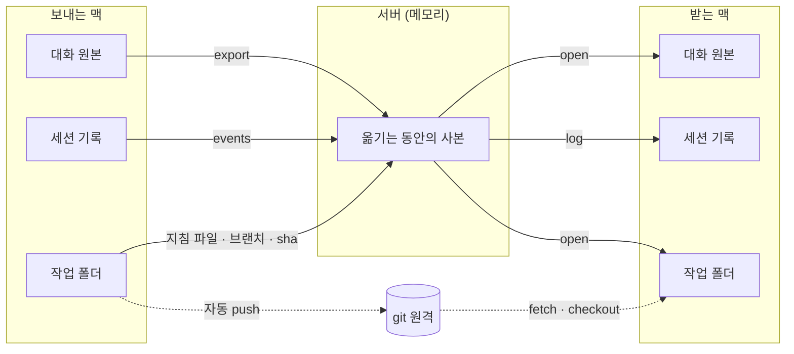
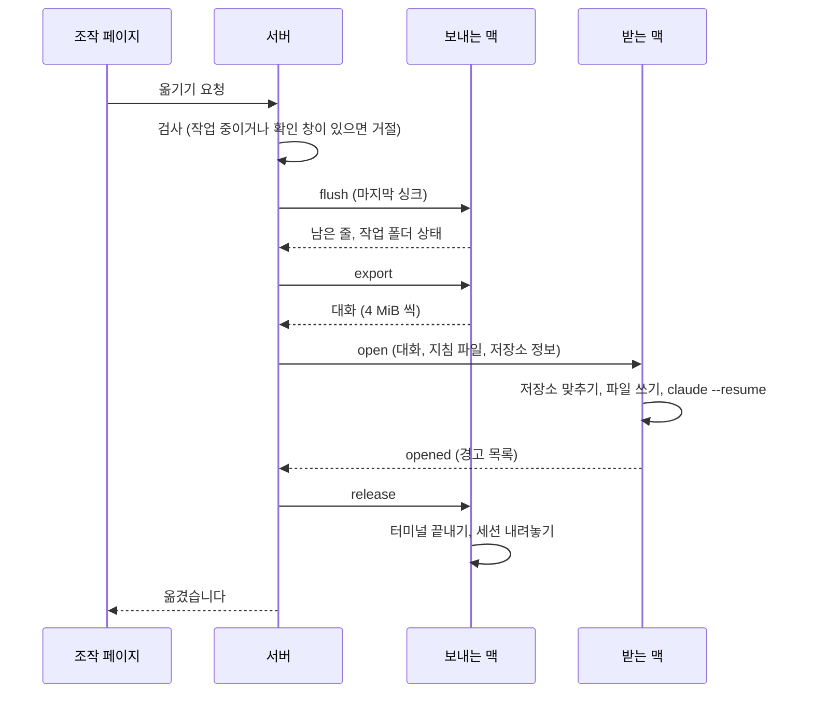

# 옮기기와 작업 폴더 싱크

이 페이지는 대화가 어디에 있고 무엇이 언제 싱크되는지, 세션이 다른 호스트(맥)로 넘어갈 때 어떤 순서로 무엇이 옮겨지는지 설명해요. 옮기는 절차는 [세션 옮기기](/guide/use/move)을 보세요.

그림처럼 대화는 맥에서 맥으로 서버를 거쳐 옮겨요. 서버는 옮기는 동안만 메모리에 사본을 두고, 코드는 git 원격을 거쳐 받는 맥에 들어가요.

## 대화는 어디에 있나요

| 위치 | 무엇이 있나요 |
|---|---|
| 세션이 도는 맥 | 대화 원본(Claude Code 의 트랜스크립트)과 세션 기록(`~/.claude-bridge/events/<세션 id>.jsonl`), 대화의 그림 |
| 서버 메모리 | 세션마다 최근 이벤트 1,000개, 옮기는 동안의 대화 **사본** |
| 서버 디스크 | 세션 정보만: 제목, 미리보기 80자, 상태, 맥, 작업 폴더, PR 링크, 통계 숫자 |
| 폰·PC 브라우저 | 그 기기에서 본 대화의 캐시(IndexedDB) |

서버는 대화 원본, 화면 이벤트, 그림을 디스크에 쓰지 않아요. 서버가 다시 시작하면 메모리가 비고, 필요한 기록은 맥에 다시 물어요.

맥이 끊기면 서버는 그 세션의 대화를 보여 줄 수 없어요. 조작 페이지는 대화 위에 "맥 연결 끊김" 띠를 보이고, 그 기기에 캐시해 둔 대화만 보여 줘요. 처음 여는 기기에는 아무것도 보이지 않아요.

::: details 예전 판의 서버에 남은 대화
예전 판의 서버는 대화 사본을 데이터 폴더에 저장했어요. 그 파일은 운영자가 정리할 때까지 남아 있어요. 정리는 운영자만 할 수 있고, 서버를 `BRIDGE_PURGE=1` 로 다시 시작해야 켜져요. 자세한 내용은 [접근 관리와 운영 화면](/guide/operate/admin)을 보세요.
:::

## 무엇을 언제 싱크하나요

| 대상 | 방향 | 언제 |
|---|---|---|
| 대화 줄 | 맥 → 서버 → 조작 페이지, 번호 매긴 이벤트는 다시 맥으로 | 새 줄이 생길 때(700 ms 주기, 글을 넣을 때, 도구나 턴이 끝날 때) |
| 작업 폴더 상태 | 맥 → 서버 | 살아 있는 세션은 30초마다, 그리고 턴이 끝난 직후 |
| 통계 숫자 | 맥 → 서버 | 턴이 끝나면 5초 안에, 그 밖에는 60초에 한 번 |
| 마지막 싱크 | 맥 → 서버 | 옮기기 직전(90초까지 기다림) |

통계는 맥의 에이전트가 계산해 숫자만 보내요. PR 링크도 에이전트가 대화에서 찾아 주소만 보내요.

## 작업 폴더 싱크 규칙

작업 폴더는 통째로 옮기지 않아요. 아래 표에 있는 것만 맞춰요.

| 작업 폴더 | 싱크하는 것 | 받는 맥에서 하는 일 |
|---|---|---|
| git 저장소가 아님 | 지침 파일 `SESSION.md`, `AGENTS.md`, `CLAUDE.md` 의 내용(파일마다 262,144 byte 이하) | 같은 이름의 파일을 받은 내용으로 써요. 내용이 다르면 원래 파일을 먼저 보관해요 |
| 작업 폴더 자체가 git 저장소 | 브랜치, 커밋 sha, `origin` 주소 | 폴더가 없으면 `clone` 하고, `fetch` 한 뒤 그 브랜치와 커밋으로 맞춰요 |
| 1단계 하위 폴더가 git 저장소 | 저장소마다 같음(`.` 으로 시작하는 폴더와 `node_modules` 를 빼고 앞 60개) | 같음 |

지침 파일 목록은 맥의 환경 변수 `CLAUDE_BRIDGE_SYNC_FILES` 로 바꿀 수 있어요. 하위 폴더의 하위 폴더처럼 더 깊은 저장소는 보지 않아요.

받는 맥은 저장소를 맞출 때 사람의 작업을 덮지 않아요.

- 커밋하지 않은 변경이 있으면 그 저장소를 건드리지 않고 경고를 남겨요.
- 받은 커밋을 원격에서 찾을 수 없으면 "원격에 푸시되지 않음" 경고를 남겨요.
- 그 맥의 브랜치가 갈라져 있으면 fast-forward 만 시도하고, 안 되면 경고를 남겨요.

경고가 있어도 옮기기는 실패로 치지 않아요. 경고는 옮긴 뒤 대화에 "확인할 것" 으로 남아요.

### 자동 push

받는 맥이 커밋을 불러오려면 그 커밋이 원격에 있어야 해요. 그래서 에이전트는 싱크할 때 다음 조건이 모두 맞으면 `git push -u origin <브랜치>:<브랜치>` 를 한 번 실행해요.

- `origin` 이 있고, 브랜치에 있어요(detached HEAD 가 아니에요).
- 브랜치가 기본 브랜치(`main`, `develop`, `master`)가 아니에요. 목록은 `CLAUDE_BRIDGE_DEFAULT_BRANCHES` 로 바꿔요.
- 세션의 자동 push 가 켜져 있어요. 기본은 켜짐이고 세션마다 끌 수 있어요.
- 그 커밋이 아직 원격에 없어요.

강제 push 는 하지 않아요. 같은 커밋으로는 한 번만 시도하고, 실패하면 그 이유를 세션의 push 상태로 보여 줘요. push 할 때 그 저장소의 git hook 은 돌리지 않아요.

## 옮기기

**옮기기**는 세션을 다른 호스트로 넘기는 일이에요. 보내는 맥과 받는 맥이 모두 연결돼 있어야 해요.

옮기기는 이 순서로 진행돼요.

1. **검사.** 세션이 작업 중이면 "작업 중입니다. 턴이 끝난 뒤에 옮겨 주세요" 로, 답하지 않은 확인 창이 있으면 "응답을 기다리는 확인 창이 있습니다. 답한 뒤에 옮겨 주세요" 로 거절해요. 지시 대기(`stuck`) 카드는 막지 않아요.
2. **마지막 싱크.** 보내는 맥이 아직 보내지 않은 줄과 작업 폴더 상태를 보내요.
3. **대화 받기.** 서버가 보내는 맥에서 대화를 4 MiB 씩 받아 메모리에 둬요.
4. **열기.** 받는 맥이 저장소를 맞추고, 지침 파일과 대화 파일을 쓰고, `claude --resume <대화 id>` 로 같은 대화를 이어 열어요. 작업 폴더가 홈 아래에 있으면 받는 맥의 홈 아래 같은 경로로 바꿔요.
5. **내려놓기.** 열기가 성공한 뒤에야 보내는 맥에 `release` 를 보내요. 보내는 맥은 터미널을 끝내고 세션을 목록에서 빼요. 대화 파일과 작업 폴더는 그 맥에 남아요.

세션 기록도 보내는 맥에서 받는 맥으로 500개씩 옮겨요. 다 옮기지 못하면 두 맥이 다시 연결됐을 때 이어서 옮겨요. 옮기기가 끝나면 서버는 메모리의 사본을 버려요.

### 실패하면

| 실패한 곳 | 결과 |
|---|---|
| 마지막 싱크 | 아무것도 바뀌지 않아요. 받는 맥에는 아무것도 보내지 않았어요 |
| 대화 받기 | 아무것도 바뀌지 않아요 |
| 받는 맥에서 열기 | 세션은 보내는 맥에 그대로 있어요. `release` 를 보내지 않았기 때문이에요 |

어느 경우든 세션이 중간에 사라지지 않아요.

## 끊겼을 때와 전환

맥이 끊기면 세션 화면에 "<맥 이름> 이(가) 연결돼 있지 않아요." 배너가 뜨고 입력칸이 막혀요. 그 맥의 브라우저에서 사이트를 다시 열면 붙어요.

서버는 끊긴 세션을 다른 맥으로 저절로 옮기지 않아요.

**전환**은 보내는 맥이 끊긴 채로 세션을 다른 맥으로 넘기는 일이에요. 지금 판에서는 전환할 수 없어요. 대화의 원본이 끊긴 맥에만 있고 서버는 사본을 갖고 있지 않기 때문이에요. 시도하면 "<맥 이름> 이 연결돼 있지 않아 옮길 수 없어요. 서버는 대화 사본을 갖고 있지 않아요. 그 맥을 켜고 연동한 뒤 다시 해 주세요" 로 거절돼요. 끝난 세션을 다른 맥에서 다시 여는 것도 원래 맥이 연결돼 있어야 해요.

## 돌아가기

**돌아가기**는 세션을 전에 있던 맥으로 다시 옮기는 일이에요. 서버는 돌아가기를 따로 다루지 않고, 같은 옮기기 절차를 밟아요.

돌아간 맥에는 예전의 대화 파일과 지침 파일이 남아 있을 수 있어요. 받는 맥은 그 파일을 지금 세션의 최신 내용으로 덮어써요. 최신은 언제나 지금 세션이 돌고 있는 쪽이에요. 덮기 전 내용이 다르면, 원래 파일을 `~/.claude-bridge/overwritten/<세션 id>-<시각>-<파일 이름>` 으로 복사해 둬요. 심볼릭 링크인 지침 파일은 덮지 않고 경고만 남겨요.

## 왜 이렇게 했나요?

**작업 폴더를 통째로 싱크하지 않아요.** 코드는 이미 git 원격이 옮겨 주므로, 브랜치와 커밋만 맞추면 받는 맥이 원격에서 가져올 수 있어요. 기본 브랜치가 아닌 커밋을 자동 push 하는 것도 그래서예요. 대가로 커밋하지 않은 변경과 git 밖의 파일은 옮겨지지 않아요. 기본 브랜치의 푸시하지 않은 커밋도 받는 맥에서 불러올 수 없어요.

**저절로 옮기지 않아요.** 세션은 한 번에 한 맥에서만 돌고, 어느 맥에서 돌지는 사람이 정해요. 옮기기가 끝나기 전에는 보내는 맥을 내려놓지 않으므로, 같은 대화가 두 맥에서 동시에 돌거나 중간에 사라지지 않아요.

**서버는 대화를 저장하지 않아요.** 서버가 다루는 개인 정보를 줄이려고 대화의 원본을 맥에 두고 서버는 중계만 해요. 대가로 맥이 꺼져 있으면 그 세션의 대화를 서버에서 볼 수 없고, 다른 맥으로 옮기거나 전환할 수도 없어요.

## 다음 단계

- [세션 옮기기](/guide/use/move): 조작 페이지에서 세션을 옮기는 절차예요.
- [맥을 늘 연결해 두기](/guide/use/always-on): 맥이 끊기지 않게 해서 옮길 수 없는 경우를 줄여요.
- [맥의 파일과 경로](/reference/files): `events/`, `overwritten/` 같은 경로 전체를 찾아봐요.
- [환경 변수](/reference/env): `CLAUDE_BRIDGE_SYNC_FILES`, `CLAUDE_BRIDGE_DEFAULT_BRANCHES` 를 찾아봐요.
