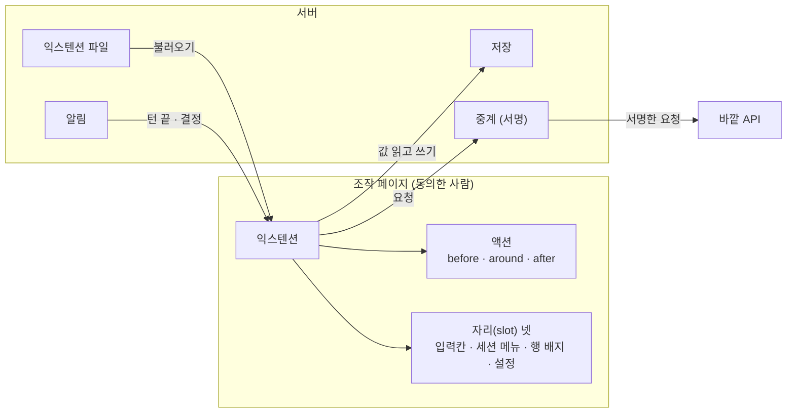

# 익스텐션 두기와 만들기

이 가이드를 마치면 예시 익스텐션을 내 서버에 올려서, 조작 페이지에 새 버튼과 메뉴가 생기는 것을 볼 수 있어요. 익스텐션이 쓸 수 있는 API 전체는 [익스텐션 API](/reference/extension-api)를 보세요.

이 페이지는 [1.371 판](/changelog) 기준이에요.

## 익스텐션은 무엇인가요?

**익스텐션**은 운영자가 서버에 둔 폴더의 스크립트예요. 사람이 동의하면 그 사람의 조작 페이지가 이 스크립트를 불러요. 익스텐션은 이런 일을 해요.

- **액션에 끼어들기**: 페이지가 하는 일(보내기, 결정 카드 답, 링크 열기, 복사 등)은 이름 붙은 **액션**으로 지나가요. 익스텐션은 그 앞(`before`), 뒤(`after`), 둘레(`around`)에 처리기를 붙여 인자를 바꾸거나 멈추거나 대신해요.
- **자리(slot)에 항목 더하기**: 입력칸의 버튼 줄, 세션 메뉴, 세션 목록 행의 배지, 설정 탭. 이 네 곳에 항목을 더하거나 페이지의 항목을 감싸고 숨겨요.
- **단축키와 시트**: 키를 등록하고, 뒤로가기로 닫히는 시트를 열어요.
- **저장과 바깥 서비스**: 사람마다·서버 전체에 작은 값을 저장하고, 서버가 중계하는 라우트로 바깥 API 를 불러요. 브라우저는 바깥으로 직접 연결하지 못해요.
- **이벤트 받기**: 턴이 끝났을 때, 결정을 기다릴 때, 결정에 답했을 때 알림을 받아요.



화면을 넓히거나 바깥 서비스와 잇는 것은 익스텐션이에요. 서버 안에 Go 로 빌드해 넣는 [플러그인](/reference/plugin-api)(Slack)과는 달라요. 익스텐션은 서버를 다시 빌드하지 않고 폴더만 두면 돼요.

::: danger 운영자가 읽은 코드만 두세요
익스텐션을 켠 사람의 페이지에서 익스텐션은 그 사람의 권한으로 동작해요. 그 사람의 맥에서 Claude 에게 메시지를 보내 명령을 실행하게 할 수 있고, 적힌 바깥 주소로 요청을 보낼 수 있어요. 남이 만든 익스텐션은 코드를 읽고 나서 두세요.
:::

## 5분 따라하기: 예시 익스텐션 올리기

저장소의 [`extensions/example`](https://github.com/CreatiCoding/agent-bridge/blob/main/extensions/example)은 API 의 각 부분을 한 번씩 써 보는 익스텐션이에요. 바깥 주소나 환경 변수를 쓰지 않아서 어느 서버에서나 불러와요.

아래 명령은 저장소를 받은 뒤 그 맨 위 폴더에서 해요.

```sh [터미널]
git clone https://github.com/CreatiCoding/agent-bridge
cd agent-bridge
```

### 1. 빌드하기 (선택)

빌드한 `dist/` 가 저장소에 들어 있어서, 고치지 않을 거면 건너뛰어도 돼요.

```sh [터미널]
cd extensions/example
corepack yarn install
corepack yarn build          # src/ → dist/
cd ../..                     # 저장소 맨 위 폴더로 돌아가기
```

### 2. 서버에 두기

익스텐션 폴더를 서버가 읽을 수 있는 곳에 둬요. 폴더 맨 위에 `extension.yaml` 이 있어야 해요. 실행 이미지에는 `extensions/` 폴더가 들어 있지 않아서, Docker 라면 폴더를 컨테이너에 마운트해요. [서버 올리기](/guide/operate/self-host)의 `docker run` 에 한 줄을 더하세요.

```sh [터미널]
  -v "$PWD/extensions/example:/ext/example:ro" \
```

docker compose 로 띄웠다면 [서버 올리기](/guide/operate/self-host)의 `docker-compose.yml` 에서 `bridge` 서비스의 `volumes:` 에 한 줄을 더하세요.

```yaml [docker-compose.yml]
      - ./extensions/example:/ext/example:ro
```

::: warning 폴더의 파일은 내려받을 수 있어요
서버는 폴더의 `.js`·`.mjs`·`.css`·`.json`·그림·글꼴 파일을 동의한 사람에게 내줘요. `package.json` 같은 파일도 내려받을 수 있어요. 폴더에 비밀값을 두지 마세요. 비밀값은 환경 변수로 넘기세요.
:::

그다음 서버 설정 파일 `bridge.yaml` 에 그 폴더를 적어요. 설정 파일이 어디 있는지는 [서버 설정 파일](/guide/operate/config)을 보세요.

```yaml [bridge.yaml]
extensions:
  - path: /ext/example           # 컨테이너 안의 경로
extensionConsent: true           # 기본값. 사람마다 동의해야 그 사람의 페이지가 불러와요
```

`path` 의 상대 경로는 `bridge.yaml` 이 있는 폴더 기준이에요. 저장소에서 서버를 직접 돌리면 설정 파일이 `<저장소>/data/bridge.yaml` 이라서 `path: ../extensions/example` 로 적어요.

서버를 다시 시작해요. 서버는 시작할 때 폴더를 메모리로 읽어서, 폴더를 고쳐도 다시 시작하기 전에는 바뀌지 않아요. 불러오지 못한 익스텐션이 있어도 서버는 떠요. 그 이유는 시작 로그와 설정 → **운영** 탭의 "익스텐션" 카드에 나와요.

익스텐션의 `extension.yaml` 은 `bridge.yaml` 이 그 익스텐션의 `env` 에 적은 환경 변수만 읽을 수 있어요.

::: details 폴더를 읽는 규칙
- 폴더의 일반 파일을 5MB 까지 읽어요. 심볼릭 링크는 읽지 않아요.
- `node_modules` 와 `.` 으로 시작하는 이름(파일·폴더)은 읽지 않아요. 그래서 폴더 안에서 빌드해도 돼요.
- 읽은 모든 파일의 경로·길이·내용으로 **해시**(sha256 앞 16자)를 만들어요. 파일이 하나라도 바뀌면 해시가 바뀌어요.
- 서버가 내주는 파일은 `.js`·`.mjs`·`.css`·`.json`·`.png`·`.jpg`·`.webp`·`.woff2` 뿐이에요. HTML·SVG·`extension.yaml` 은 404 예요.
- 같은 id 의 익스텐션이 둘이면 뒤의 것은 불러오지 않아요.
- `extension.yaml` 의 모르는 키, 서버가 모르는 `extensionApi`, 익스텐션에 허락하지 않은 훅(`before`, `exec`)이 있으면 그 익스텐션만 불러오지 않아요.
- **환경 변수**: `env` 에 없는 이름을 `${이름}` 으로 읽으면 그 익스텐션을 불러오지 않아요. 그 줄이 주석 안에 있어도 같아요. YAML 큰따옴표 문자열 안에서 `$` 를 `\u0024` 로 써서 `"\u0024{이름}"` 처럼 숨겨도 같아요. 그래서 익스텐션이 로그인 비밀값 같은 서버의 다른 환경 변수를 바깥으로 보낼 수 없어요. `$${이름}` 은 환경 변수가 아니라 글자 `${이름}` 으로 읽어요.
:::

### 3. 동의하고 써 보기

1. 조작 페이지를 새로 고쳐요. "익스텐션을 켤까요?" 에서 **켜기**를 눌러요.
2. 세션을 열고 입력칸에 글을 써요. 보내기 버튼 앞에 "? 붙여 보내기" 버튼이 생겨요. 누르거나 입력칸에서 ⌥⇧Q(다른 OS 는 Alt+Shift+Q)를 누르면 글 끝에 `?` 를 붙여 보내요.
3. 세션 메뉴에서 **메모**를 눌러요. 시트에 메모를 쓰고 저장하면, 세션 목록의 그 행에 "메모" 배지가 생겨요.
4. 설정 → 플러그인에 "턴이 끝나면 알림" 스위치가 생겨요. 켜 두면 턴이 끝날 때 열린 페이지가 여럿이어도 한 번만 알려요.
5. Claude 에게 ` ```checklist ` 블록으로 답해 달라고 해 봐요. `- [x] 끝남` 같은 줄이 체크 상자로 그려져요.

### 4. 내 익스텐션 만들기

`example/` 을 복사하고 `extension.yaml` 의 `id`·`name`·`uses` 를 바꿔요. 가장 작은 익스텐션은 이래요.

```ts [src/index.ts]
import type { Bridge } from '../../agent-bridge-ext'

export default function setup(bridge: Bridge) {
  bridge.actions.before('composer.submit', (a) => ({ ...a, text: a.text?.trim() }))
  bridge.slots.register('settings.section', {
    id: 'hello',
    render: () => bridge.React.createElement('p', null, `안녕, ${bridge.user.login}`),
  })
}
```

`import 'react'` 같은 bare import 는 쓸 수 없어요. 페이지의 `bridge.React` 를 쓰고, 폴더 안 다른 파일은 상대 경로로 불러요. 예시는 classic JSX 를 TypeScript 로 빌드해서 `bridge.React` 로 그려요(`example/src/jsx.ts`). `uses` 에 적지 않은 액션·slot 을 쓰면 페이지가 거절해요.

::: tip 고치면서 바로 보기
서버를 환경 변수 `BRIDGE_EXT_DEV=1` 로 띄우면 2초마다 폴더를 다시 읽어요. 바뀌면 열린 페이지가 새로 고쳐져요. 파일 캐시도 끄니까 개발할 때만 쓰세요. 해시가 바뀌므로 다시 동의를 물어요.
:::

## 사람마다 동의하기

익스텐션은 동의한 사람의 페이지에서만 동작해요. 동의는 사람마다, **해시**마다 따로예요.

- 페이지를 열면, 아직 동의하지 않은 익스텐션마다 "익스텐션을 켤까요?" 를 한 번 물어요. 이름·버전·해시, 할 수 있는 일, 쓰는 액션·slot, 요청을 보내는 곳(출처)을 보여 줘요.
- **켜기**를 누르면 바로 불러와요. **켜지 않기**를 누르면 이 브라우저에서는 그 해시에 대해 다시 묻지 않아요.
- 나중에 켜고 끄려면 설정 → **플러그인** 탭의 "익스텐션" 카드에서 스위치를 바꿔요. 바꾸면 화면을 다시 불러와요.
- 운영자가 익스텐션 파일을 고쳐 해시가 바뀌면, 모두 다시 동의해야 해요.

운영자가 모두에게 묻지 않고 켜려면 `bridge.yaml` 에 `extensionConsent: false` 를 적어요. 그러면 모두 동의한 것으로 봐요.

::: details 동의에 관한 더 많은 규칙
- 동의는 서버의 `u/<uid>/ext-consent.json` 에 해시로 저장돼요.
- 묻는 창은 최상위 창에서만 떠요. 분할 화면의 칸에서는 묻지 않아요.
- 데모 계정에는 익스텐션이 없어요.
- 플러그인 탭은 서버 기능 `slack` 을 끄면 탭 줄에서 사라져요. 그래도 주소 `/settings/plugins` 로 열면 "익스텐션" 카드가 보여요.
- 처리방침과 설정 화면의 수신처 목록에 익스텐션의 라우트와 훅이 보내는 곳(출처만)이 실려요.
:::

## 익스텐션 끄기

| 하려는 것 | 방법 |
|---|---|
| 지금 탭만 익스텐션 없이 열기 | 주소 끝에 `?noext=1` 을 붙여요. 이 탭(분할 칸 포함)에서 다시 불러와도 유지돼요. `?noext=0` 으로 풀어요 |
| 나만 끄기 | 설정 → 플러그인 → "익스텐션" 카드에서 스위치를 꺼요 |
| 서버에서 빼기 | `bridge.yaml` 의 `extensions` 에서 그 항목을 지우고 서버를 다시 시작해요 |

익스텐션 때문에 화면이 이상하면 먼저 `?noext=1` 로 열어 보세요. 그래도 같으면 익스텐션 문제가 아니에요.

::: details 서버에서 뺀 익스텐션의 남은 데이터
`bridge.yaml` 에서 뺀 익스텐션의 저장 값은 그대로 남아요. 운영 탭의 "익스텐션" 카드에 "빠진 익스텐션 … 의 데이터가 남아 있어요" 와 정리 버튼이 보여요. 누르면 그 id 의 서버 값과 모든 사람의 값을 지워요(`GET`·`POST /api/admin/ext-leftovers`, 관리자만).

화면에서 난 오류(처리기 오류, 시간 초과, 항목 그리기 오류, 불러오기 오류)도 같은 카드에 익스텐션 이름으로 모여요.
:::

## 바깥 서비스와 잇기

브라우저는 바깥으로 직접 연결할 수 없어요. 그래서 바깥 데이터는 서버가 중계해요. `extension.yaml` 에 **라우트**를 적으면, 익스텐션은 `bridge.api.json('/docs/pages')` 처럼 불러요. 서버는 누가 요청했는지 헤더에 담고 서명해서 upstream 으로 보내요.

```yaml [extension.yaml]
server:
  routes:
    - path: /docs/                               # bridge.api.json('/docs/pages') → upstream + pages
      upstream: https://api.example.com/v1/
      signingSecret: ${EXAMPLE_SIGNING}          # 16자 이상
      headers:
        Authorization: "Bearer ${user.apiToken}" # 그 사람이 bridge.storage.secrets.set('apiToken', …) 로 둔 값
  hooks:
    session.done.after:                          # 동의한 사람의 이벤트만 가요
      - type: webhook
        url: https://hooks.example.com/done
        secret: ${NOTIFY_SECRET}
```

이 예에서는 `bridge.yaml` 의 그 익스텐션 항목에 `env: [EXAMPLE_SIGNING, NOTIFY_SECRET]` 를 적어야 해요.

받는 쪽의 서명 확인은 서버 훅과 같아요. [알림 웹훅과 훅](/guide/operate/hooks#예-1-턴이-끝나면-내-웹훅으로-받기)의 "예 1" 아래 **받는 쪽에서 서명 확인하기** 를 펼쳐 보세요.

::: details 라우트가 지키는 것
- 경로: `/api/ext/<id>/call/<경로>` 의 GET·POST 만 받아요. `..`, `.` 조각, `%2f`·`%5c`·`%2e`, 역슬래시가 있으면 400 이에요.
- 넘기는 브라우저 헤더는 `Accept`·`Accept-Language`·`If-None-Match`·`If-Modified-Since` 뿐이에요. 쿠키는 넘기지 않아요.
- 서버가 붙이는 헤더: `X-Bridge-User`·`X-Bridge-Login`·`X-Bridge-Timestamp`·`X-Bridge-Nonce`·`X-Bridge-Signature: v1=<hex>`. hex 는 `signingSecret` 으로 만든 HMAC-SHA256 이에요. 정규 문자열은 `v1`, timestamp, nonce, 메서드, upstream 쪽 경로와 쿼리, user, login, sha256(본문) hex 를 줄바꿈으로 이은 것이에요. 받는 쪽은 같은 문자열을 만들어 비교하고, 5분 넘게 차이 나는 timestamp 와 5분 안에 본 nonce 를 거절하세요.
- `headers` 에 `X-Bridge-*`·`Cookie`·`Host` 같은 헤더는 쓸 수 없어요. 값의 `${user.KEY}` 는 요청 때 그 사람의 비밀값으로 바뀌고, 비밀값이 없으면 그 헤더를 빼고 보내요.
- 한도: 요청 본문 1MB(413), 답 5MB·10초(넘으면 502). 리다이렉트는 따르지 않고 502 예요.
- 답의 형식은 `application/json`·`text/plain`·`image/png`·`jpeg`·`gif`·`webp` 만 받아요. 아니면 502 예요. 답에는 `Content-Security-Policy: sandbox`, `nosniff`, `no-store` 를 붙이고 `Set-Cookie` 는 지워요.
- 라우트의 `path` 는 `/` 로 시작하고 끝나야 하고, 서로 겹칠 수 없어요. `upstream` 은 `http(s)://호스트/경로` 모양이에요.
:::

::: details 익스텐션의 서버 훅
- `server.hooks` 는 `<액션·이벤트>.after` 와 `webhook` 만 받아요. `before` 와 `exec` 는 운영자의 `bridge.yaml` `hooks` 에서만 써요. 사람이 동의를 거둬도 운영자의 보호 장치가 꺼지지 않게 하려는 것이에요.
- 그 익스텐션에 동의한 사람의 이벤트에만 보내요. 본문은 서버 훅과 같고 `extension: <id>` 가 붙어요. 실패해도 다시 보내지 않아요.
- 서버가 내는 이벤트의 본문은 [알림 웹훅과 훅](/guide/operate/hooks#서버가-내는-이벤트)의 "서버가 내는 이벤트" 를 보세요.
:::

## 다음 단계

- [익스텐션 API](/reference/extension-api): `bridge` 객체, 액션, slot, 저장, 이벤트, `extension.yaml` 의 모든 키
- [`extensions/agent-bridge-ext.d.ts`](https://github.com/CreatiCoding/agent-bridge/blob/main/extensions/agent-bridge-ext.d.ts): 공개 타입 원본
- [`extensions/README.md`](https://github.com/CreatiCoding/agent-bridge/blob/main/extensions/README.md): 저장소의 짧은 안내
